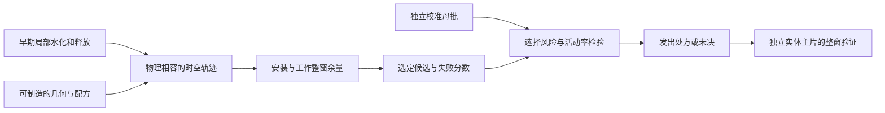

# 时空材料逆设计的论文主张与证据

建议标题为 **Designing Functional Time Windows from Sparse Hydrogel Observations under Manufacturing and Mechanism Constraints**。如果按计算研究提交，重点是时间窗、有限观测与可选工艺之间的关系。真实部署主张需要按现有独立验证计划补证。 [ICML Application-driven 征稿口径](https://icml.cc/Conferences/2027/CallForPapers)

| 主张 | 证据 | 需要保留的边界 |
|---|---|---|
| 两次局部空间读数能改善未来用途判断 | 不同水化方程并改变其参数，保持同读数次数、同模型和同动作，对比整体与局部水化。独立重现 Brier 方向，再给监督森林相同读数 | 变化机制下最强同信息森林的 Brier 与物理模型差异未定。选材正遗憾有分离证据。实体设备时间、噪声与试样深度未知 |
| 目录内插和扩制造维度改变的是两件事 | 9→25 的容量与实际达标小于登记实用门槛。厚度±15% 在固定离子面库存与相近方案数下，使足够多请求新出现可行方案 | 厚度牵动多个物理尺度。必须确认离子面库存守恒、分层配方实际可制造和机械装夹符合同一设计定义 |
| 扩展厚度给可验证的模拟决策带来增益 | 在已分别通过 10% 风险目标的两套冻结规则下，640 个新模拟母批上达标交付增加 3.95 个百分点，配对 95% 区间 [2.89, 4.98] | 分布是事先声明的模拟机制混合。学习评分的吞吐虽然更高，未通过独立风险检验，作为失败对照保留 |
| 可预测性、达标可行性和可发放量可以分别度量 | 同母批全目录真实输出用于画像，原始决策给出选择损失，最终冻结政策用新校准母批检验条件风险和活动率 | 分组共形覆盖、边际失败及条件失败各自不同。精确检验需要验证随机流、分组独立、目标机制或指定机制混合 |
| 局部与联合过程任务有真实公开证据 | 湿化布里渊剖面的一条完整时序、干式弹性体的同片应力与相对电阻、吸胀和降解的早段/晚段时钟检查 | 这些实测拆分支持若干子问题。在同一目标水凝胶和同一新制备母批联合量测之前，不写成湿时窗处方已得到独立材料验证 |

已有工作覆盖目标导向逆问题、下游损失主动学习、联合时间序列及有限样本风险控制。稿件把新增知识落在**用等量局部观测结合可制造的介入方向扩大功能窗口、用独立验证区分物理无解与选择失误**。算法中的二项检验、后验轨迹和分位数排序以现有方法引用。涉及湿态厚度、弱湿误触发、跨厚度共同离子面库存的证据必须实体提供。 [直接近邻](TOP_CONFERENCE_NEAREST_NEIGHBORS_ZH.md) · [本轮可复算数值和负结果](WINDOW_GAP_CLOSURE_20261117_ZH.md)

主文按“定义任务与物理观察”“解释局部观测的收益与风险”“实验证明控制范围和可行性”“用同一动作约束量化相同风险目标下的实际交付”组织。原始数据登记和独立审计放补充材料。首轮独立性不成立的风险计算保留为更正记录，与有效研究主表区分。 [独立性更正](WINDOW_RANDOM_STREAM_CORRECTION_ZH.md) · [实物执行入口](WINDOW_CONFIRMATION_EXECUTION_ZH.md)
